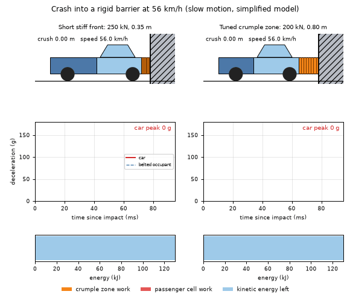
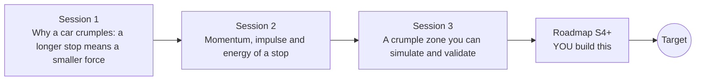

# opencrashsim

[](https://github.com/KrunalPanchal1995/opencrashsim/actions/workflows/ci.yml)   [](https://colab.research.google.com/github/KrunalPanchal1995/opencrashsim/blob/main/sessions/session-01/lesson.ipynb) [](https://krunalpanchal1995.github.io/opencrashsim/)

**Design a crumple zone with momentum and energy, in three sessions.**

opencrashsim teaches why cars crumple, from F = m v^2 / (2 d) to a time-stepped crumple model checked against energy and momentum, using only Python and a browser.

- **Start from one formula.** Session 1 needs only school algebra: F = m v^2 / (2 d) explains the whole idea.
- **See it crash.** Every session ships a slider app that runs in the browser, with labelled graphs.
- **Know you got it right.** Each session ends with a checkpoint that prints PASS or FAIL against hand calculations and an exact reference solution.
- **Build the missing half.** The repo stops at Session 3 on purpose; the roadmap shows the path to the Target.

[Target](#the-target) · [Who is this for](#who-is-this-for) · [Quick start](#quick-start) · [Sessions](#sessions) · [Roadmap](#roadmap) · [Contribute](#contribute) · [Explainer PDF](docs/explainer.pdf)

> **This repo is incomplete on purpose.** Sessions 1 to 3 are here and fully working. The finished Target below is a preview of what the community can build next. We show you the path, not the code. Sessions 4 and up are yours.

## The Target

Two cars hit a rigid barrier at 56 km/h in slow motion. On the left a short, stiff front runs out of crumple length: the passenger cell is crushed and the deceleration trace shoots up to about 167 g in a sharp second spike. On the right a tuned crumple zone collapses at a steady force, the trace stays flat near 20 g, and the energy bar shows nearly all of the kinetic energy absorbed by the crumple zone. A belted occupant adds a second trace. Your goal over the coming sessions: build that two-mass model with an occupant and a belt, tune a staged crumple profile, and reproduce the animation.



*Target: a short stiff front that bottoms out (left) versus a tuned crumple zone (right), with live deceleration trace and energy bar*

Try it live:

- [Math Visual Studio: work and energy (Atlas S38)](https://krunalpanchal1995.github.io/studio/#atlas?ch=S38&ex=1)
- [Math Visual Studio playground (momentum and collisions, Atlas S39, has no live example yet)](https://krunalpanchal1995.github.io/studio/)

How the Target was made is shown only as a path in [promo/roadmap.md](promo/roadmap.md).

## Who is this for
**secondary school to diploma / undergraduate (levels 3-5).** Topic area: Physics and the Science of Motion.

Prerequisites:

- School algebra and the idea of speed and force (F = m a).
- Python 3.10 or newer; if `python --version` works, you are ready. PRIMER.md explains the rest.
- No prior GitHub, calculus or vehicle-engineering experience is needed.

New to Python? Read [PRIMER.md](PRIMER.md) first (10 minutes).

## Quick start

No installation knowledge needed. You need [Git](https://git-scm.com/downloads) and [Python 3.10+](https://www.python.org/downloads/) (Windows: tick "Add Python to PATH"). On Mac and Linux type `python3` wherever this page says `python`.

```bash
git clone https://github.com/KrunalPanchal1995/opencrashsim.git
cd opencrashsim
python start.py 1
```

`start.py` creates a private environment, installs what is needed and runs Session 1 with its checkpoint. Next: `python start.py 2`, `python start.py 3`, or `python start.py test` to check everything. Only a checkpoint: `python start.py check 1`.

Four lines turn the idea of Session 1 into a result (they work as they are): Save it as `try.py` and run it with `python start.py run try.py` (this uses the private environment, where NumPy is installed):

```python
import numpy as np
m, v, d = 1000.0, 50 / 3.6, 0.5          # car mass (kg), speed (m/s), crumple distance (m)
F = m * v**2 / (2 * d)                   # average stopping force from work = kinetic energy
print(round(F / 1000, 1), "kN =", round(F / m / 9.81, 1), "g")   # -> 192.9 kN = 19.7 g
```

Every session also opens in your browser with sliders (no install): [live apps](https://krunalpanchal1995.github.io/opencrashsim/). Or use the Colab badge above for the notebook.

## Sessions

| # | Session | Model level | Time | Live app |
|---|---|---|---|---|
| 1 | [Why a car crumples: a longer stop means a smaller force](sessions/session-01/README.md) | Level 1: conceptual interactive model | 60 min | [open](https://krunalpanchal1995.github.io/opencrashsim/session-01/) |
| 2 | [Momentum, impulse and energy of a stop](sessions/session-02/README.md) | Level 2: mathematical engineering model | 75 min | [open](https://krunalpanchal1995.github.io/opencrashsim/session-02/) |
| 3 | [A crumple zone you can simulate and validate](sessions/session-03/README.md) | Level 3: simulation and validation | 90 min | [open](https://krunalpanchal1995.github.io/opencrashsim/session-03/) |

Each session follows the same six steps: A real-world problem, B concept and theory, C visual explanation, D interactive simulation, E worked example and experiment, F assessment and design challenge. Each ends with `checkpoint.py`, which prints `PASS` or `FAIL` against reference numbers. Session 3 also contains the real-world mini-project: **Choose the crumple zone for a small car at 56 km/h**.

## Architecture



| Folder or file | What is inside |
|---|---|
| `sessions/` | three sessions: README (A-F), `lesson.py`, notebook, live app, exercises, activity sheet, checkpoint |
| `promo/` | the Target: media, live links, and the roadmap (path only) |
| `docs/` | `explainer.tex` and the built `explainer.pdf` |
| `tests/` | runs every lesson and checkpoint headless |
| `start.py` | one command to set up and run anything |
| `QUALITY.md`, `RUBRIC.md` | the quality checklist and the scoring rubric |
| `.github/` | CI, PDF build, Pages deploy, issue and PR templates |

## Roadmap

| Milestone | What you will build | Difficulty |
|---|---|---|
| Session 4: Add an occupant and a belt | A second mass of 75 kg connected to the car by a belt with 30 mm slack, 80 kN/m stiffness and 1500 N s/m damping, with the belt reaction acting back on the car. | intermediate |
| Session 5: A staged crumple profile | A force law with two plateaus and a transition length, swept over 40, 56 and 64 km/h. | intermediate |
| Session 6: Rebound and restitution | An unloading path for the force curve so that the car can leave the barrier. | intermediate |
| Session 7: Off-centre crash with yaw | A 2D rigid car with yaw inertia 1500 kg m^2 hitting a barrier 0.5 m off the centreline with the same plateau force law. | advanced |
| Session 8: Reproduce the Target animation | A side-by-side GIF of a bottoming-out design and a tuned design, each with a car picture, a live deceleration trace and an energy split. | advanced |

Full detail with a checkpoint per milestone: [promo/roadmap.md](promo/roadmap.md).

## Contribute
New to GitHub? Read [CONTRIBUTING.md](CONTRIBUTING.md); it starts from zero. Pick an issue labelled `good first issue`. Translations into Hindi, Telugu, Tamil and Malayalam are welcome.

<details>
<summary>Development</summary>

```bash
python start.py test        # runs every lesson and checkpoint
```
Lessons use `# %%` cell markers so they open as notebooks in VS Code. See [QUALITY.md](QUALITY.md) for the standard every session meets.
</details>

## License
MIT. See [LICENSE](LICENSE). Media in `promo/media` is (c) Krunal Panchal, CC BY 4.0.

## Acknowledgments
Part of the [PAN IIT OSS](https://hellofoss.tech-iitb.org/projects) open-source teaching collection, modelled on the structure of [openspline](https://github.com/openspline/openspline). Built on ideas from the Math Visual Studio at https://krunalpanchal1995.github.io/studio/.
