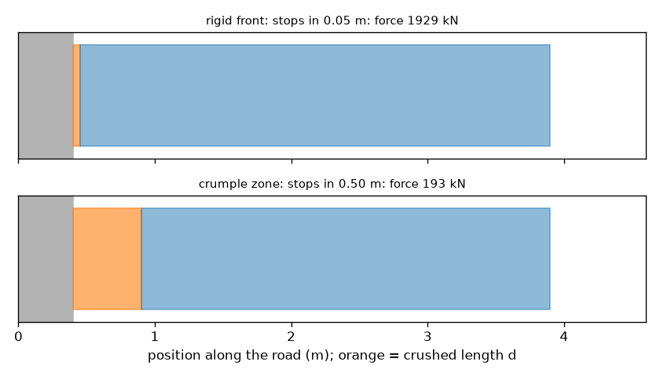
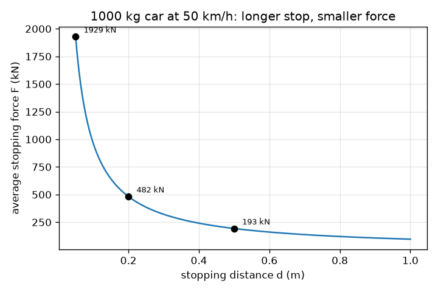

# Session 1: Why a car crumples: a longer stop means a smaller force

*Level 1 (conceptual interactive model) · about 60 minutes · opencrashsim*

> This is a simplified educational model. It is not a validated design tool and must not be used for real structures, electrical installations, vehicles, industrial processes or medical decisions.

**Prerequisites**

- School algebra: rearranging a formula.
- You have read PRIMER.md and run `python start.py 1` once.

**Learning objectives.** After this session you can:

- Explain why a longer stopping distance gives a smaller average force.
- Compute kinetic energy and the average stopping force F = m v^2 / (2 d), with units.
- Convert a force into a deceleration in g and see that g does not depend on mass.
- Read a graph of stopping force against stopping distance.

## A. Real-world problem
A car hits a wall. The wall does not move, so the car has to stop within whatever distance the car itself provides. A stiff, rigid front stops the car in a few centimetres and the force is enormous. A front that crumples stops it over about half a metre and the force is far smaller. How does the stopping distance control the force? (This is general physics education, not a vehicle safety guide.)

## B. Concept and theory
A car of mass m moving at speed v carries kinetic energy KE = (1/2) m v^2. To stop, all of that energy must be removed. A force F pushing back over a distance d does work F d. If the force is constant, setting work equal to energy gives F d = (1/2) m v^2, so F = m v^2 / (2 d). The force is inversely proportional to the distance: double the crumple distance and the force halves. Newton's second law F = m a turns the force into a deceleration a = v^2 / (2 d), which does not depend on the mass. We write a as a multiple of g = 9.81 m/s^2, so 'a = 20 g' means 20 times the pull of gravity. The speed must be in metres per second: divide km/h by 3.6.

| Symbol | Meaning | Unit |
|---|---|---|
| m | mass of the car | kg |
| v | speed just before the crash | m/s |
| d | stopping distance (crumple distance) | m |
| KE | kinetic energy | J |
| F | average stopping force | N |
| a | average deceleration | m/s^2 |
| g | gravitational acceleration, 9.81 | m/s^2 |

**Assumptions**

- The force is constant over the whole stopping distance (average force).
- The car is one rigid lump moving in a straight line into an immovable wall.
- There is no rebound: the car ends at rest.
- Simplified educational model: not a crashworthiness design tool, no injury predictions.

$$ KE=\tfrac12 m v^2 $$

$$ F\,d=\tfrac12 m v^2\quad\Longrightarrow\quad F=\dfrac{m v^2}{2d} $$

$$ a=\dfrac{F}{m}=\dfrac{v^2}{2d}\qquad\text{in g units: } \dfrac{a}{g} $$

## C. Visual explanation
The first figure plots the average force on a 1000 kg car at 50 km/h against the stopping distance: a falling curve with 1929 kN at 0.05 m, 482 kN at 0.20 m, 193 kN at 0.50 m and 96 kN at 1.00 m. The second figure draws the car and the wall twice: with a rigid front (0.05 m of crush) and with a crumple zone (0.50 m). The longer orange block is the crushed length, and the force quoted above each picture is 10 times smaller for the crumple zone.

*Rigid front (0.05 m of crush) versus crumple zone (0.50 m): about 1929 kN versus 193 kN.*

*Average stopping force against stopping distance for a 1000 kg car at 50 km/h.*

## D. Interactive simulation
Run the lesson (`python start.py 1`), then open the live app: [Session 1: why a car crumples](https://krunalpanchal1995.github.io/opencrashsim/session-01/) (or `app.html` in this folder). Slide the crumple distance from 0.05 m to 1 m and watch the force arrow, the colour of the crumple block and the g value change. Then double the speed and see what happens. Mass changes the force but not the g.

**Challenge.** Keep the average deceleration at or below 20 g at 50 km/h by choosing a crumple distance.

## E. Worked example and experiment
**Problem.** A 1000 kg car at 50 km/h is stopped by a crumple zone over 0.5 m. Find the average force and the deceleration in g.

1. Convert the speed: 50 km/h / 3.6 = 13.89 m/s.
2. Kinetic energy: KE = 0.5 * 1000 * 13.89^2 = 96450 J (96.5 kJ).
3. Force: F = KE / d = 96450 / 0.5 = 192900 N = 192.9 kN.
4. Deceleration: a = F / m = 192900 / 1000 = 192.9 m/s^2.
5. In g: 192.9 / 9.81 = 19.7 g.
6. Sanity check: a = v^2 / (2 d) = 192.9 / 1.0 = 192.9 m/s^2, the same.

**Answer.** The average force is 192.9 kN, a deceleration of 19.7 g.

**Experiment.** Roll a toy car down a ramp into a wall faced with a stack of folded paper or a small block of foam, and film it from the side with a phone at slow motion. Measure how far the front crushes and compare two foam thicknesses: the thicker one should crush further and the car should be thrown back less. Real crushing is not a constant force and some energy goes into sound, heat and a rebound, so the real stopping distance differs from the model, and the toy cannot show forces in g.

## F. Assessment and design challenge
**Question type A: Conceptual.** A heavy truck and a small car hit a wall at the same speed and both stop in 0.5 m. Which has the larger average force? Which has the larger deceleration? Explain.

Hint

Compare F = m v^2 / (2 d) and a = v^2 / (2 d).

Step-by-step solution

The truck has the larger force because F is proportional to m. The deceleration a = v^2 / (2 d) has no mass in it, so both have the same deceleration. The truck's occupants feel the same g, but the truck's structure must carry a bigger force, which is why heavy vehicles need stronger, longer structures.

**Question type B: Numerical.** A 1500 kg car at 36 km/h is stopped in 0.4 m. Find the average force (in kN) and the deceleration (in g). Check your answer another way.

Hint

36 km/h is 10 m/s. Use F = m v^2 / (2 d) and a = F / m.

Step-by-step solution

v = 36 / 3.6 = 10 m/s. F = 1500 * 10^2 / (2 * 0.4) = 150000 / 0.8 = 187500 N = 187.5 kN. a = 187500 / 1500 = 125 m/s^2 = 125 / 9.81 = 12.7 g. Check: a = v^2 / (2 d) = 100 / 0.8 = 125 m/s^2, the same.

**Question type C: Graph and simulation interpretation.** On the force-versus-distance graph for a 1000 kg car at 50 km/h the force at d = 0.2 m is about 482 kN. Without a calculator, what is the force at d = 0.4 m and at d = 0.1 m? What is the curve called and why is it never zero?

Hint

F is proportional to 1 / d.

Step-by-step solution

Doubling the distance halves the force: 241 kN at 0.4 m. Halving the distance doubles it: 965 kN at 0.1 m. The curve is a hyperbola F = KE / d. It never reaches zero because a finite energy needs some force over any finite distance; it gets small only for very long stops.

**Question type D: Design and optimisation challenge.** Design: a 1000 kg car at 50 km/h must be stopped with an average force of at most 150 kN. What is the smallest crumple distance? Pick a practical value to the nearest 0.05 m and state the trade-off.

Hint

Rearrange F = KE / d to d = KE / F and round up.

Step-by-step solution

KE = 96450 J, so d = 96450 / 150000 = 0.643 m. Round up to 0.65 m (rounding down would exceed 150 kN): F = 96450 / 0.65 = 148.4 kN, a = 14.8 g. Trade-off: a longer crumple zone lowers the force but makes the car longer or heavier, and the model assumes a constant force, which a real structure only approximates.

Score yourself with [RUBRIC.md](../../RUBRIC.md). Print the [activity sheet](activity_sheet.md) to work on paper.

## Common misconceptions
| Common misconception | What is actually true |
|---|---|
| A stronger, stiffer front is always safer. | A rigid front stops the car in a very short distance, so the force and deceleration are very large. Crumpling spreads the same energy over a longer distance. |
| A heavier car feels a larger deceleration because the force is larger. | The force is larger, but a = F / m, so the mass cancels: a = v^2 / (2 d) is the same for any mass. |
| Doubling the speed doubles the force. | Energy grows with v^2, so at the same stopping distance the force is four times as large. |
| Energy is destroyed in a crash. | Kinetic energy is converted, mostly into the work of bending and crushing metal, plus a little heat and sound. Energy is conserved. |

## Glossary
- **kinetic energy**: energy of motion, (1/2) m v^2, measured in joules
- **work**: force times distance along the force, in joules
- **crumple zone**: part of the car designed to collapse and absorb energy
- **g (as a unit)**: a deceleration expressed as a multiple of 9.81 m/s^2
- **average force**: the constant force that does the same work over the same distance

## Finish
1. Do the three coding tasks in [exercises.md](exercises.md).
2. Run `python start.py 1` again after your changes. It ends with the checkpoint; when it prints `PASS`, you are done. (Checkpoint only: `python start.py check 1`.)

Next: [Session 2](../session-02/README.md)
