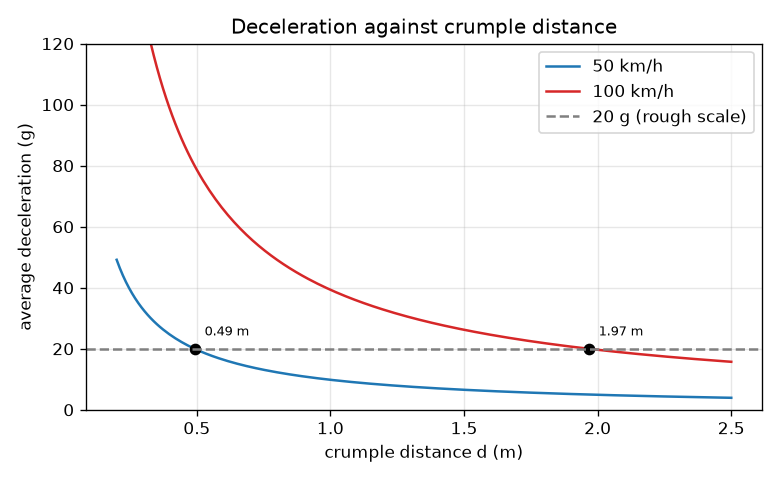
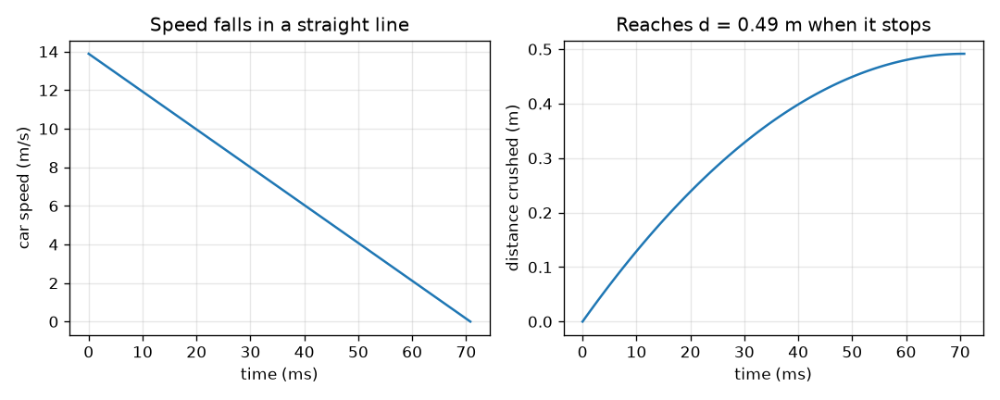

# Session 2: Momentum, impulse and energy of a stop

*Level 2 (mathematical engineering model) · about 75 minutes · opencrashsim*

> This is a simplified educational model. It is not a validated design tool and must not be used for real structures, electrical installations, vehicles, industrial processes or medical decisions.

**Prerequisites**

- Session 1: F = m v^2 / (2 d).
- Newton's second law F = m a.

**Learning objectives.** After this session you can:

- Use momentum p = m v and the impulse F t = change of momentum.
- Show that the impulse view and the work-energy view give the same force.
- Compute average deceleration a = v^2 / (2 d) and express it in g.
- Solve a design problem: choose a crumple distance for a deceleration limit, and show the square law with speed.

## A. Real-world problem
A crash lasts only a few hundredths of a second. Session 1 used energy and distance. There is a second, independent way: momentum and time. Can the two views agree? And can we use them to answer a design question: how much crumple distance keeps the driver's deceleration below 20 g (a commonly quoted rough scale for brief loads, not a safety rule) when the car hits at 50 km/h? What changes at 100 km/h? This lesson is general physics education and makes no injury predictions.

## B. Concept and theory
Momentum is p = m v. Newton's second law says F = dp/dt, so a force F acting for a short time dt delivers an impulse F dt equal to the change in momentum. For a constant force lasting a time t that stops the car, F t = m v. For the same stop, the work-energy theorem gives F d = (1/2) m v^2. With constant deceleration the average speed during the stop is v/2, so d = (v/2) t and t = 2 d / v. Putting this t into F t = m v returns F = m v^2 / (2 d): the two views agree. The deceleration is a = F / m = v^2 / (2 d) and the g-force is a / g. Solving for the distance needed to stay below a g-limit: d = v^2 / (2 (limit) g). Because d is proportional to v^2, doubling the speed needs four times the distance for the same g.

| Symbol | Meaning | Unit |
|---|---|---|
| p | momentum m v | kg m/s |
| F t | impulse of a constant force | N s |
| t | duration of the stop | s |
| d | crumple (stopping) distance | m |
| a | average deceleration | m/s^2 |
| g-limit | chosen limit on a / g (20 here) | no unit |
| v | impact speed | m/s |

**Assumptions**

- Constant force (constant deceleration) during the stop.
- One lump of mass in a straight line into an immovable wall, no rebound.
- The 20 g limit is only a commonly cited rough scale for brief loads; it is not a safety rule or an injury prediction.
- Simplified educational model, not a crashworthiness design tool.

$$ F\,t=m v\qquad F\,d=\tfrac12 m v^2 $$

$$ t=\dfrac{2d}{v}\quad\Longrightarrow\quad F=\dfrac{m v}{t}=\dfrac{m v^2}{2d} $$

$$ a=\dfrac{v^2}{2d},\qquad \text{g-force}=\dfrac{a}{g} $$

$$ d_{\min}=\dfrac{v^2}{2\,(\text{limit})\,g}\qquad v_{\max}=\sqrt{2\,(\text{limit})\,g\,d} $$

## C. Visual explanation
The first figure plots the deceleration in g against the crumple distance for 50 km/h and 100 km/h, with the 20 g line dashed. The blue curve crosses it at 0.49 m and the red curve at 1.97 m: four times as far. The second figure shows the stop itself from 50 km/h in 0.49 m: speed falls in a straight line to zero in 70.8 ms, and the distance crushed grows as a parabola up to 0.49 m.

*Deceleration against crumple distance at 50 and 100 km/h; the 20 g line is crossed at 0.49 m and 1.97 m.*

*Speed and distance crushed during a 70.8 ms stop from 50 km/h in 0.49 m.*

## D. Interactive simulation
Run the lesson (`python start.py 2`), then open the live app: [Session 2: momentum, impulse and energy of a stop](https://krunalpanchal1995.github.io/opencrashsim/session-02/) (or `app.html` in this folder). Choose a speed and slide the crumple distance until the red dot falls below the green 20 g line. Switch to the speed-time view to see how long the stop lasts. Then double the speed and compare the grey curve.

**Challenge.** Keep the deceleration at or below 20 g at 100 km/h or more by choosing a crumple distance.

## E. Worked example and experiment
**Problem.** Find the crumple distance that keeps a 1000 kg car at 50 km/h to 20 g, the duration of the stop, and the force. Then do the same at 100 km/h.

1. v = 50 / 3.6 = 13.89 m/s. The limit is a = 20 g = 20 * 9.81 = 196.2 m/s^2.
2. Distance: d = v^2 / (2 a) = 192.9 / (2 * 196.2) = 0.4917 m.
3. Time: t = 2 d / v = 2 * 0.4917 / 13.89 = 0.0708 s = 70.8 ms.
4. Force by impulse: F = m v / t = 1000 * 13.89 / 0.0708 = 196 kN. By energy: F = KE / d = 96450 / 0.4917 = 196 kN. They agree.
5. At 100 km/h: v = 27.78 m/s, so d = 771.6 / 392.4 = 1.966 m and t = 141.6 ms. The speed doubled, so the distance is 4 times as large (4 * 0.4917 = 1.967 m).

**Answer.** About 0.49 m at 50 km/h (70.8 ms, 196 kN) and about 1.97 m at 100 km/h (141.6 ms): the same g needs 4 times the distance.

**Experiment.** Use a phone's slow-motion video of a trolley or toy car that runs into a soft stop, and read the stopping distance from the frames and the duration from the frame count (for example 240 frames per second). Compare d with (v / 2) t, which should agree if the deceleration is roughly constant. Real stops are not exactly constant-force (the force rises at first), so the measured d is usually a little different from the model's, and a phone video cannot measure forces directly.

## F. Assessment and design challenge
**Question type A: Conceptual.** Why does doubling the speed need four times the crumple distance for the same deceleration, rather than twice?

Hint

Look at where v appears in d = v^2 / (2 a).

Step-by-step solution

The distance needed is d = v^2 / (2 a), and v appears squared. Equivalently the kinetic energy grows as v^2, and at a fixed force the distance to absorb it must grow as v^2. Doubling v makes v^2 four times larger. In the time view the stop also lasts twice as long, and the average speed during it is twice as large, so distance = average speed times time is four times larger.

**Question type B: Numerical.** A 1000 kg car hits at 80 km/h. What crumple distance keeps the average deceleration at or below 20 g? What speed can a 0.6 m crumple zone handle at 20 g?

Hint

80 km/h is 22.22 m/s. Use d = v^2 / (2 * 20 * 9.81) and v = sqrt(2 * 20 * 9.81 * d).

Step-by-step solution

d = 22.22^2 / (2 * 20 * 9.81) = 493.8 / 392.4 = 1.26 m. For d = 0.6 m: v = sqrt(392.4 * 0.6) = sqrt(235.4) = 15.34 m/s = 55.2 km/h. Check: a = 15.34^2 / (2 * 0.6) = 196.2 m/s^2 = 20 g.

**Question type C: Graph and simulation interpretation.** On the graph, a 1 m crumple distance at 50 km/h and at 100 km/h gives what g-forces? Which stays below the 20 g line?

Hint

Read the two curves at d = 1.0 m, or compute a = v^2 / (2 d).

Step-by-step solution

At 50 km/h: a = 192.9 / 2 = 96.4 m/s^2 = 9.8 g, below the 20 g line. At 100 km/h: a = 771.6 / 2 = 385.8 m/s^2 = 39.3 g, above it, four times the 50 km/h value. The red curve only drops below the 20 g line beyond d = 1.97 m.

**Question type D: Design and optimisation challenge.** Design: a car must meet 20 g at 64 km/h but the crumple zone is limited to 0.6 m. Is that possible? If not, what is the least distance, and what are the options (lower speed, higher g, more distance)? State the trade-offs.

Hint

Compute d for 64 km/h = 17.78 m/s and compare with 0.6 m.

Step-by-step solution

d = 17.78^2 / 392.4 = 316.0 / 392.4 = 0.805 m, which is more than 0.6 m, so it is not possible: with 0.6 m the deceleration would be 316 / 1.2 / 9.81 = 26.8 g. Options: lengthen the crumple zone to 0.81 m (longer, heavier car), accept a higher g (a different, harder target) or reduce the speed the zone is designed for (0.6 m handles 55.2 km/h at 20 g). Any real design balances these with cost, space, pedestrian safety and many other things the model ignores.

Score yourself with [RUBRIC.md](../../RUBRIC.md). Print the [activity sheet](activity_sheet.md) to work on paper.

## Common misconceptions
| Common misconception | What is actually true |
|---|---|
| Momentum and energy tell different stories about a crash. | Both give the same force for a constant-force stop: F = m v / t = m v^2 / (2 d). Time and distance are linked by d = (v/2) t. |
| A 20 g limit is a safe/unsafe switch. | It is only a rough scale for brief loads. Real injury depends on duration, direction, restraint and the person; this model predicts none of that. |
| Doubling the speed doubles the crumple distance needed. | It quadruples it, because the distance is proportional to v^2. |
| Mass appears in the deceleration formula. | a = v^2 / (2 d) has no mass. Mass matters for the force and for the energy to absorb, not for a. |

## Glossary
- **momentum**: mass times velocity, m v, in kg m/s
- **impulse**: force times time, F t; equals the change in momentum
- **work-energy theorem**: the work done on an object equals its change in kinetic energy
- **g-force**: acceleration written as a multiple of g = 9.81 m/s^2
- **square law**: a quantity that grows with the square of another, like energy with speed

## Finish
1. Do the three coding tasks in [exercises.md](exercises.md).
2. Run `python start.py 2` again after your changes. It ends with the checkpoint; when it prints `PASS`, you are done. (Checkpoint only: `python start.py check 2`.)

Next: [Session 3](../session-03/README.md)
