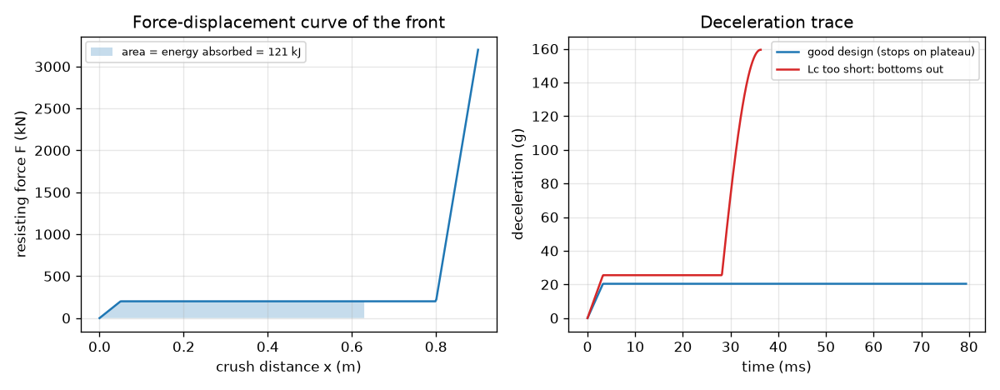
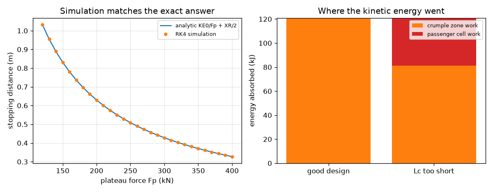

# Session 3: A crumple zone you can simulate and validate

*Level 3 (simulation and validation) · about 90 minutes · opencrashsim*

> This is a simplified educational model. It is not a validated design tool and must not be used for real structures, electrical installations, vehicles, industrial processes or medical decisions.

**Prerequisites**

- Sessions 1 and 2: F = m v^2 / (2 d), impulse, g-force.
- The idea of a time step: advancing a motion in many tiny steps.

**Learning objectives.** After this session you can:

- Build a lumped crumple model with a force-displacement curve and step it through time with RK4.
- Validate peak deceleration, stopping distance and stop time against the exact constant-force solution, and audit the energy balance.
- Analyse a two-car collision: momentum conservation, inelastic collision, relative speed and mass ratio.
- Explain and reproduce a failure case: the crumple zone bottoms out and a second, much larger spike appears.

## A. Real-world problem
Real crumple zones do not push back with one constant force. The front first resists more and more, then collapses at a roughly steady force (the plateau), and if it is used up the stiff passenger cell is next and the force jumps. Can we model this with a few lines of code, step it through time, check it against the exact formulas from Sessions 1 and 2, and use it to choose a plateau force and a crumple length for a small car at 56 km/h? This is a classroom model: not a crashworthiness design tool, and it makes no injury predictions.

## B. Concept and theory
The car is one lump of mass m crushing a front structure that resists with a force F(x) that depends on the crush distance x. The curve has three parts: a short ramp from 0 to the plateau force Fp over a length XR = 0.05 m, a constant plateau Fp up to the crumple length Lc, and beyond Lc a very stiff passenger cell with F = Fp + k (x - Lc), k = 3e7 N/m. Newton's law is m dv/dt = -(F(x) + c v) and dx/dt = v, with an optional damping coefficient c (default 0). We step these in time with the fourth-order Runge-Kutta method (RK4) and shorten the last step so the car stops exactly at v = 0. The work done by the force is the area under F(x), and the energy balance reads KE0 = work in the crumple zone and cell + energy lost in the damper + residual KE. If the crash ends on the plateau the exact answers are d = KE0 / Fp + XR / 2 and peak deceleration Fp / m. For two cars m1 and m2 meeting head on, momentum is conserved; if they lock together (perfectly inelastic) vf = (m1 v1 + m2 v2) / (m1 + m2) and the energy to be crushed is (1/2) mu v_rel^2 with mu = m1 m2 / (m1 + m2). The same simulation runs with mass mu at the relative speed, through both crumple zones in series.

| Symbol | Meaning | Unit |
|---|---|---|
| m | car mass | kg |
| x | crush distance | m |
| Fp | plateau force | N |
| Lc | crumple length | m |
| XR | length of the force ramp (0.05) | m |
| k | stiffness of the passenger cell (3e7) | N/m |
| c | damping coefficient (default 0) | N s/m |
| mu | reduced mass of two cars | kg |
| v_rel | relative speed of two cars | m/s |

**Assumptions**

- One lump of mass, one dimension, a rigid barrier or a head-on line; no rebound (the car stays crushed).
- A hand-made force curve (ramp, plateau, stiff cell), not measured data.
- No occupant, belt, airbag or injury model: this is not a crashworthiness design tool and predicts no injuries.
- The 25 g target in the mini-project is a teaching target, not a safety rule.

$$ F(x)=\begin{cases}F_p\,x/X_R & 0\le x<X_R\\ F_p & X_R\le x\le L_c\\ F_p+k\,(x-L_c) & x>L_c\end{cases} $$

$$ m\,\dfrac{dv}{dt}=-\big(F(x)+c\,v\big),\qquad \dfrac{dx}{dt}=v $$

$$ d=\dfrac{KE_0}{F_p}+\dfrac{X_R}{2},\qquad a_{\max}=\dfrac{F_p}{m} $$

$$ KE_0=\int_0^{x_{\rm end}}F\,dx+\int c\,v^2\,dt+KE_{\rm end} $$

$$ v_f=\dfrac{m_1 v_1+m_2 v_2}{m_1+m_2},\qquad \Delta KE=\tfrac12\,\mu\,v_{\rm rel}^2,\quad \mu=\dfrac{m_1 m_2}{m_1+m_2} $$

## C. Visual explanation
The first figure has two panels. Left: the force-displacement curve of a 200 kN plateau with a 0.8 m crumple length; the shaded area (121 kJ) is the energy absorbed. Right: the deceleration traces of a good design (flat at 20.4 g) and of a 250 kN / 0.35 m design that bottoms out: a flat 25.5 g plateau for 28 ms and then a spike to 159 g at the end. The second figure shows on the left the RK4 stopping distance (dots) lying on the exact line KE0 / Fp + XR / 2, and on the right the energy split: in the failing design the passenger cell absorbs 40 kJ of the 121 kJ.

*Force-displacement curve (left) and deceleration traces of a good design and a design that bottoms out (right).*

*RK4 stopping distance versus the exact formula (left) and the energy split between crumple zone and passenger cell (right).*

## D. Interactive simulation
Run the lesson (`python start.py 3`), then open the live app: [Session 3: crumple zone simulation](https://krunalpanchal1995.github.io/opencrashsim/session-03/) (or `app.html` in this folder). Choose the speed, plateau force and crumple length. Watch the car body, the deceleration trace and the force curve. Slide the crumple length down until the zone bottoms out and a spike appears.

**Challenge.** Meet the mini-project limits at 56 km/h: peak at most 25 g, crumple length at most 0.70 m, and the car stops within 95 percent of the crumple length.

## E. Worked example and experiment
**Problem.** A 1000 kg car hits a rigid barrier at 56 km/h with Fp = 200 kN and Lc = 0.8 m. Find the stopping distance and the peak deceleration, and check them against the simulation and the energy balance.

1. v = 56 / 3.6 = 15.556 m/s, so KE0 = 0.5 * 1000 * 15.556^2 = 120988 J (121.0 kJ).
2. The ramp (0 to 0.05 m) absorbs half of Fp * XR = 0.5 * 200000 * 0.05 = 5000 J.
3. The remaining 120988 - 5000 = 115988 J is absorbed on the plateau: 115988 / 200000 = 0.5799 m.
4. Total stopping distance d = 0.05 + 0.5799 = 0.6299 m. It is less than Lc = 0.8 m, so the crash ends on the plateau and the formula applies (equivalently KE0 / Fp + XR / 2 = 0.6049 + 0.025).
5. Peak deceleration = Fp / m = 200000 / 1000 = 200 m/s^2 = 20.39 g.
6. The RK4 simulation gives 0.6299 m, 20.39 g and a stop time of 79.4 ms, matching the exact values; the energy balance KE0 = crumple work + residual KE closes to about 1e-11 of KE0.

**Answer.** Stopping distance 0.630 m, peak deceleration 20.4 g, stop time 79.4 ms; the simulation matches and the energy balance closes.

**Experiment.** Crush a row of empty drinks cans or a stack of cardboard tubes in a vice or under a slow, steady press while a kitchen scale or a force gauge records the force, and plot force against crush distance: you will see a rise, a bumpy plateau and then a steep rise when the cans are flat. Compare the area under your curve with the energy of a falling weight dropped on the same stack. The model's single smooth plateau differs from the real bumpy curve, and real crumpling depends on the speed of loading, so the experiment shows the shape, not the numbers.

## Real-world application and mini-project: Choose the crumple zone for a small car at 56 km/h
A small car of 1000 kg hits a rigid barrier at 56 km/h. Using `simulate_crash` from Session 3, choose the plateau force Fp (steps of 10 kN, from 100 to 400 kN) and the crumple length Lc (steps of 0.05 m, from 0.30 to 0.70 m) so that three limits hold: peak deceleration at most 25 g (a teaching target, not a safety rule), a crumple length of at most 0.70 m (the space under the bonnet), and the car stops within 95 percent of Lc (a safety margin so the zone does not bottom out). Among the designs that pass, pick the one with the lowest peak deceleration, and explain what you gave up for it. This is a classroom exercise in a simplified model, not a real vehicle design.

**Deliverable:** A script that prints a table of every Fp and Lc tried with peak deceleration and stop distance, marks which designs pass, names the chosen design, and saves a picture of its deceleration trace and force-displacement curve.

**Success looks like:** Your sweep names Fp = 190 kN and Lc = 0.70 m (peak about 19.4 g, stop distance 0.662 m), and it shows that a 180 kN plateau fails the margin (stop distance 0.697 m is above 0.665 m) and a 250 kN plateau fails the 25 g limit.

## F. Assessment and design challenge
**Question type A: Conceptual.** For a fixed crumple length and impact energy, why is a flat force plateau the best force-displacement curve for keeping the peak deceleration low?

Hint

The area under the curve must equal the kinetic energy.

Step-by-step solution

The area under F(x) over the crush length equals the energy to absorb, so the average force is fixed at KE0 / d. Any curve that is higher than the average somewhere must be lower elsewhere, and its peak is above the average. A flat curve has no peak above the average, so for the same energy and length it gives the lowest possible peak deceleration. Real structures cannot be perfectly flat and need a ramp at the start, which is why the model has one.

**Question type B: Numerical.** A 1200 kg car hits a barrier at 40 km/h; its crumple zone has Fp = 150 kN, XR = 0.05 m and a long length. Find the stopping distance and the peak deceleration.

Hint

v = 11.11 m/s. Use d = KE0 / Fp + XR / 2 and a = Fp / m.

Step-by-step solution

KE0 = 0.5 * 1200 * 11.11^2 = 74074 J. d = 74074 / 150000 + 0.025 = 0.4938 + 0.025 = 0.519 m. Peak a = 150000 / 1200 = 125 m/s^2 = 12.7 g. Check that Lc is at least 0.52 m, otherwise the zone bottoms out.

**Question type C: Graph and simulation interpretation.** In the deceleration-trace figure the failing design is flat at 25.5 g for about 28 ms and then climbs to 159 g. What happened, which part of the force curve produced the spike, and why does it come at the end of the crash?

Hint

Where is the car when the force curve passes x = Lc?

Step-by-step solution

The crumple length Lc = 0.35 m was used up while the car still had kinetic energy (the plateau only absorbed about 81 kJ of the 121 kJ). The car then compressed the stiff passenger cell, where the force rises steeply with x. Since the car's speed is lowest at the end, the spike occurs at the end of the crash, just before the car stops, and it is far larger than the plateau value because the cell is nearly rigid. This is the bottoming-out failure.

**Question type D: Design and optimisation challenge.** Design: for a 1000 kg car at 56 km/h choose Fp (steps of 10 kN) and Lc (steps of 0.05 m) so that peak deceleration is at most 22 g, Lc is at most 0.65 m and the car stops within 95 percent of Lc. Justify your choice.

Hint

Peak deceleration is Fp / (m g), and the stop distance is KE0 / Fp + XR / 2 = 120988 / Fp + 0.025.

Step-by-step solution

The peak limit gives Fp <= 22 * 1000 * 9.81 = 215.8 kN. The margin gives 120988 / Fp + 0.025 <= 0.95 * 0.65 = 0.6175 m, so Fp >= 204.2 kN. On a 10 kN grid only Fp = 210 kN works, with Lc = 0.65 m: peak 21.4 g and stop distance 0.601 m. Fp = 200 kN stops in 0.630 m (too long) and Fp = 220 kN gives 22.4 g (too high). The window is narrow: a tighter g limit needs a longer crumple zone.

Score yourself with [RUBRIC.md](../../RUBRIC.md). Print the [activity sheet](activity_sheet.md) to work on paper.

## Common misconceptions
| Common misconception | What is actually true |
|---|---|
| If a simulation agrees with itself, it is right. | A simulation must be checked against something independent: here the exact formula d = KE0 / Fp + XR / 2 and the energy balance. |
| In a head-on crash of two equal cars each car suffers twice the force of hitting a wall. | Each car crushes as if it hit a rigid wall at its own speed: the stopping force is the same for both and equals the force from hitting a wall at that speed. |
| A bigger car is always safer in a collision. | The lighter car has the larger deceleration (a = F / m) in a two-car crash, but the model also shows heavier cars need more crumple length for the same force. It cannot say anything about injuries. |
| More crumple force is always better because it stops the car sooner. | A larger plateau force gives a shorter stop but a larger peak deceleration (peak = Fp / m). The design has to balance both, and a zone that is too short bottoms out. |

## Glossary
- **plateau force**: the roughly constant force with which the crumple zone collapses
- **bottoming out**: the crumple zone is used up and the stiff structure behind it is loaded
- **RK4**: fourth-order Runge-Kutta, a time-stepping method that samples the slope four times per step
- **inelastic collision**: a collision in which the bodies stick together and kinetic energy is lost
- **reduced mass**: mu = m1 m2 / (m1 + m2), the effective mass of a two-body collision
- **energy balance**: the check that all the initial kinetic energy is accounted for

## Finish
1. Do the three coding tasks in [exercises.md](exercises.md).
2. Run `python start.py 3` again after your changes. It ends with the checkpoint; when it prints `PASS`, you are done. (Checkpoint only: `python start.py check 3`.)

Next: the [roadmap](../../promo/roadmap.md). Session 4 is yours to build.
